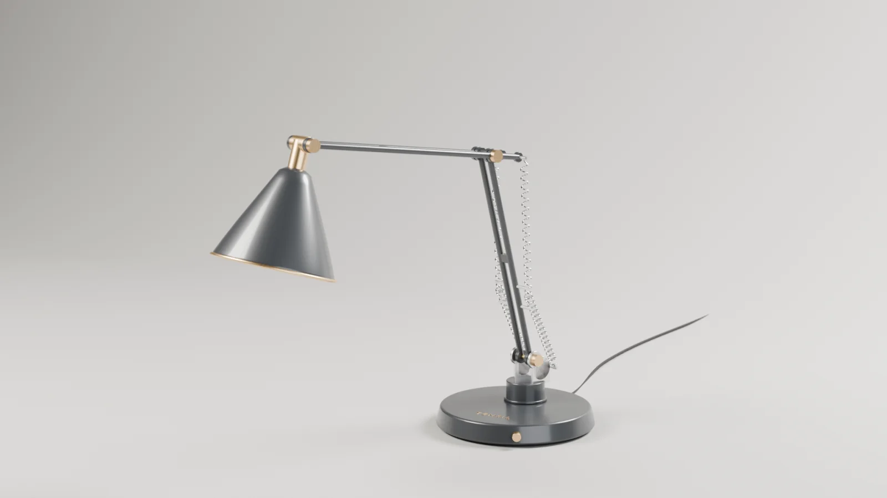
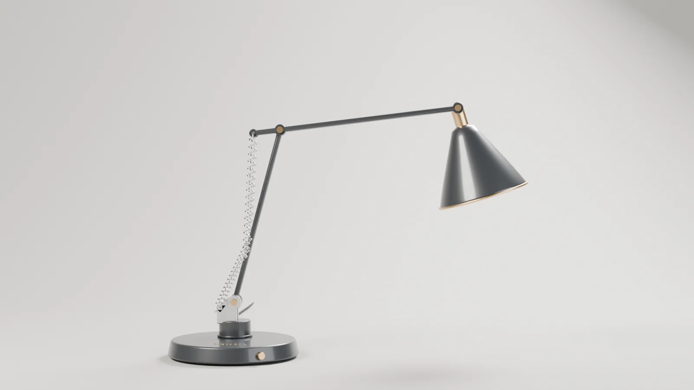
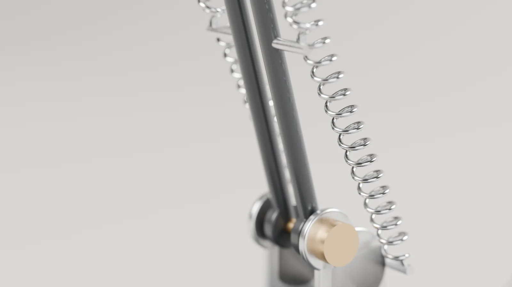
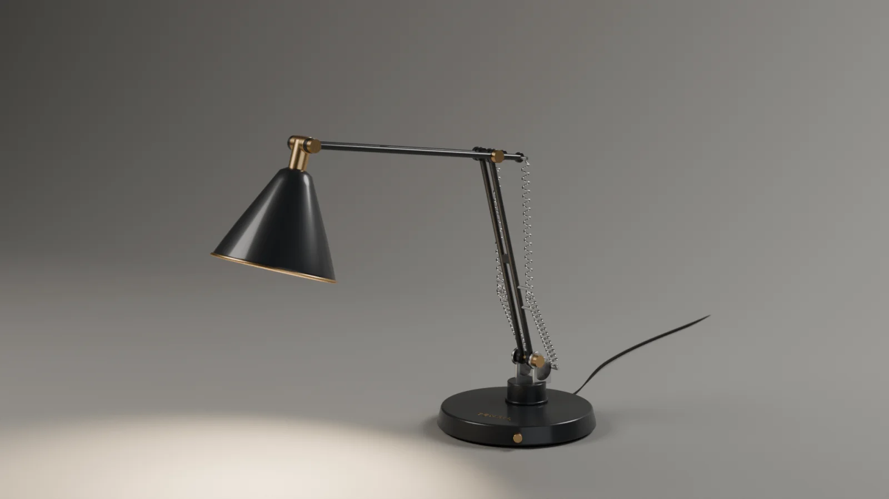

# TENSIL — lampe articulée en studio (Blender)

> Statut : **livré** — brief validé le 2026-10-15, voir [docs/BRIEF.md](docs/BRIEF.md).



## 1. But du projet
Concevoir et présenter un produit 3D complet, une lampe de bureau articulée à ressorts de la marque fictive **TENSIL**, du modèle jusqu'à l'asset web. Tout le projet est généré par des **scripts Python Blender reproductibles**.

Projet réalisé en **duo humain + IA** :
- **Elliott Lanza** : concept, public, style, coloris, nom de marque, validation de chaque étape.
- **Claude (Anthropic, via Claude Code)** : écriture et exécution des scripts `bpy`, rendus, export web, documentation.

## 2. Ce qu'il démontre
- **Modélisation mécanique procédurale :** pièces assemblées, biseaux, profil de révolution pour l'abat-jour, ressorts hélicoïdaux.
- **Rig :** hiérarchie de pivots ; les ressorts suivent les angles grâce à des contraintes *Stretch To*.
- **Matériaux PBR sans texture :** laque avec vernis, métal brossé par bruit étiré, laiton, caoutchouc, ampoule émissive.
- **Éclairage studio :** 3 boîtes à lumière sur un fond cyclo, puis bascule vers la lumière propre de la lampe.
- **Animation produit :** dépliement articulé décalé, studio qui s'assombrit, allumage avec scintillement.
- **Optimisation web :** GLB compressé avec Meshopt et animation fusionnée en un seul clip.
- **Pipeline automatisé :** une commande reconstruit la scène et refait tous les rendus.

## 3. Outils et versions
| Outil | Version | Rôle |
|---|---|---|
| Blender | 5.2.2 LTS | Modélisation, rendu Cycles (OptiX), export glTF, encodage MP4 et WebP |
| glTF-Transform CLI | 4.5.1 (via `npx`) | Optimisation, compression et validation du GLB |
| Claude Code (Claude Opus 5.5) | — | Écriture et exécution des scripts |
| Matériel | RTX 2050 avec 4 Go de VRAM, 16 Go de RAM, Windows 11 | Rendu local |

## 4. Étapes de création
1. **Cadrage et brief :** choix du concept, du style, du coloris et de la marque ([docs/BRIEF.md](docs/BRIEF.md)).
2. **Volumes et proportions :** rendus clay de contrôle.
3. **Modélisation détaillée et rig** : [`lamp.py`](blender/scripts/lamp.py).
4. **Matériaux** : [`materials.py`](blender/scripts/materials.py), avec 4 coloris testés et graphite retenu.
5. **Studio, lumières et caméras** : [`studio.py`](blender/scripts/studio.py).
6. **Animation** : [`animate.py`](blender/scripts/animate.py).
7. **Rendus finaux, visuels de processus et post-traitement** : [`build.py`](blender/scripts/build.py), [`postprocess.py`](blender/scripts/postprocess.py).
8. **Export web** : [`export_web.py`](blender/scripts/export_web.py), puis glTF-Transform.

### Reproduire
```bash
B="C:/Program Files/Blender Foundation/Blender 5.2/blender.exe"
# scène + 4 images finales (~140 s sur RTX 2050)
"$B" -b --factory-startup --python blender/scripts/build.py -- --samples 256 --save blender/tensil_lamp.blend \
  --out renders/final --shot 01_hero:CAM_Hero:work:-20 --shot 02_profile:CAM_Profile:work:90 \
  --shot 03_detail:CAM_Detail:work:-20 --shot 04_lit:CAM_Hero:work:-20:on
# visuels processus : --override clay | wire, ou --shot lighting_overview:CAM_Overview:work:-20
# animation (240 images) puis MP4
"$B" -b --factory-startup --python blender/scripts/build.py -- --animate --samples 96 --out renders/anim_frames --frames all
"$B" -b --factory-startup --python blender/scripts/postprocess.py -- video renders/anim_frames animation/tensil_unfold.mp4 30
# GLB
"$B" -b --factory-startup --python blender/scripts/export_web.py -- --out web/tensil_lamp_raw.glb
npx @gltf-transform/cli@4.5.1 optimize web/tensil_lamp_raw.glb web/tensil_lamp.glb --compress meshopt
```

## 5. Exports
| Fichier | Format | Caractéristiques |
|---|---|---|
| `renders/final/01–04_*.png` | PNG 1920×1080 | Héros, profil, gros plan sur le ressort, lampe allumée. 256 échantillons, débruitage OptiX |
| `renders/web/*.webp` | WebP 1600 px (qualité 85) | Versions web des images finales et de processus, 178 Ko au total |
| `renders/web/card.webp` | WebP 1200×675 | Vignette pour la carte portfolio |
| `animation/tensil_unfold.mp4` | MP4 H.264, 1080p, 30 i/s, 8 s | Dépliement puis allumage, sans son, 2,6 Mo. 96 échantillons, environ 13 s par image (environ 55 min au total) |
| `web/tensil_lamp.glb` | GLB avec Meshopt | Pose de travail, 203 Ko, environ 41 300 triangles |
| `web/tensil_lamp_animated.glb` | GLB avec Meshopt | 1 clip de 8 s (12 canaux), 201 Ko |
| `blender/tensil_lamp.blend` | Blender | Scène générée, 362 Ko, réservée au travail (pas pour les visiteurs) |

### Choix du format web
| Option | Verdict |
|---|---|
| **GLB (glTF binaire)** | **Retenu.** Un seul fichier, standard Khronos, lu par three.js et `<model-viewer>`, et gère l'animation |
| glTF + .bin séparés | Équivalent, mais plusieurs fichiers à héberger |
| USDZ | Utile seulement pour l'AR sur iOS. Non produit (hors périmètre) |
| FBX / OBJ | Pas adaptés au web : pas de PBR standard (OBJ), format propriétaire (FBX) |

| Compression | Taille | Note |
|---|---|---|
| Aucune (brut) | 1,03 Mo, 48 412 triangles | Référence |
| **Meshopt** | **203 Ko** | **Retenue.** Décodeur léger, compresse aussi l'animation |
| Draco | 115 Ko | Plus petit, mais le décodeur WebAssembly est plus lourd à charger. Non versionné, se régénère avec `--compress draco` |

`optimize` simplifie aussi le maillage (48 412 → environ 41 300 triangles). Un rendu de contrôle après réimport dans Blender n'a montré aucune perte visible. Matériaux : extensions `KHR_materials_clearcoat` et `KHR_materials_transmission`. Un lecteur qui ne les gère pas affiche une version plus simple. Le support Meshopt du lecteur choisi est **à vérifier lors de l'intégration** : il faut déclarer `MeshoptDecoder` dans three.js.

## 6. Ressources tierces et licences
Aucune texture, aucun HDRI ni modèle externe. Le détail est dans [docs/CREDITS.md](docs/CREDITS.md).

## 7. Coût
**0 €** engagé, aucun frais futur prévu. Voir [docs/COSTS.md](docs/COSTS.md).

## 8. Limites connues
- **Ressorts :** ils s'étirent par mise à l'échelle et ne simulent aucune physique. En gros plan, les crochets restent simplifiés.
- **Câble :** il est statique et ne suit pas l'animation, mais il part de la base, donc reste cohérent.
- **Ampoule :** son allumage n'est pas dans le GLB, car glTF n'anime pas l'intensité d'émission sans extension.
- **Wireframe :** sur le visuel wireframe, le maillage du fond reste visible.
- **Nom TENSIL :** recherche indicative seulement (USPTO). L'INPI et l'EUIPO n'ont pas été consultés. Voir le brief.
- **Bruit dans l'animation :** elle est rendue à 96 échantillons avec débruitage, donc un léger bruit temporel est possible dans les zones sombres.

## 9. Visuels pour le portfolio
Voir [docs/PORTFOLIO.md](docs/PORTFOLIO.md).

| Héros | Profil |
|---|---|
|  |  |
| **Détail** | **Allumée** |
|  |  |

**Processus :** [clay](renders/web/clay_hero.webp) · [wireframe](renders/web/wire_hero.webp) · [wireframe détail](renders/web/wire_detail.webp) · [plateau d'éclairage](renders/web/lighting_overview.webp) · [coloris testés](renders/web/colorways_test.webp)

## Documentation
- [Brief, références et tâches](docs/BRIEF.md)
- [Étude de cas](docs/CASE_STUDY.md)
- [Intégration portfolio](docs/PORTFOLIO.md)
- [Crédits & licences](docs/CREDITS.md)
- [Coûts](docs/COSTS.md)
